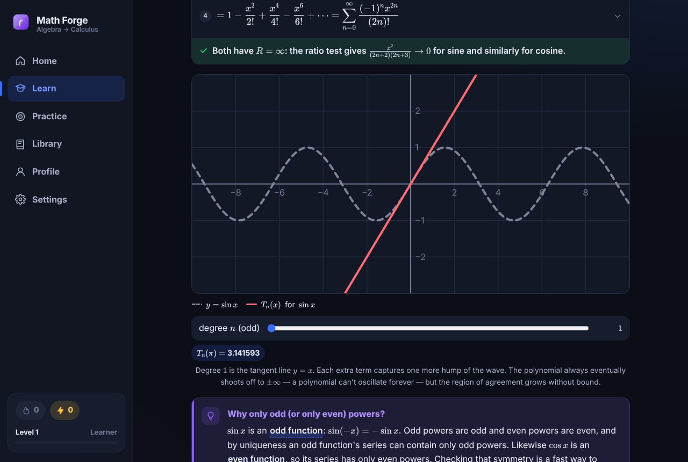

# STEM Forge

*(formerly STEM Forge)*

**Math — College Algebra, Trigonometry, Calculus I, Calculus II and Linear Algebra — and
Chemistry, with deep, interactive lessons.** STEM Forge is a Windows and Android app in the spirit of Sololearn and Duolingo,
with more depth: every lesson explains *why* each rule works, walks through complete worked
examples step by step, lets you play with live graphs, and makes you calculate real answers.
It is a sibling of C++ Forge and shares its engine.



- **Seven complete courses (224 lessons)**
  - **College Algebra:** 10 units — numbers and exponents, polynomials and factoring,
    equations and inequalities, lines, systems and matrices, quadratics and complex
    numbers, functions, polynomial and rational functions, exponentials and logarithms,
    sequences and the binomial theorem.
  - **Trigonometry:** 9 units — radians, right triangles, the unit circle, trig graphs,
    inverse trig and `atan2`, identities, trig equations, oblique triangles, vectors,
    polar coordinates and complex numbers in polar form.
  - **Calculus I:** 8 units — limits, continuity, the derivative, every differentiation
    rule, related rates and Newton's method, curve analysis and optimization, integrals
    and the Fundamental Theorem, and first applications.
  - **Calculus II:** 6 units — volumes, arc length and work, every integration technique,
    numerical integration, differential equations and Euler's method, parametric and
    polar calculus, sequences and series, and Taylor series.
  - **Linear Algebra:** 8 units — vectors, dot and cross products, linear systems and row
    reduction, linear independence and transformations (rotations, shears, reflections),
    matrix algebra and the 4×4 homogeneous matrices game engines use, determinants, vector
    spaces and change of basis, eigenvalues and Markov chains, and orthogonality, least
    squares and the SVD.
  - **Chemistry Foundations:** 5 units — matter, measurement and dimensional analysis,
    atoms and the periodic table, ionic and covalent bonding with Lewis structures and
    VSEPR shapes, equations, the mole and stoichiometry, and solutions, gases, acids and
    bases. Chemical notation is typeset with mhchem, and lessons include hand-drawn
    diagrams (Lewis structures, orbital boxes, particle pictures).
  - **General Chemistry:** 12 units — the full two-semester university course: electronic
    structure, bonding theory (hybridization, MO theory), aqueous and redox reactions,
    thermochemistry, gases, liquids and solids, solutions, kinetics, equilibrium, acid–base
    and solubility equilibria, thermodynamics, electrochemistry, and nuclear and
    transition-metal chemistry. Organic Chemistry is next.
- **Rich lessons:** beautifully typeset math (KaTeX), worked examples where you tap any
  line to see *why* that step is allowed, interactive graphs with sliders (watch a secant
  become a tangent, Riemann rectangles converge, a sinusoid shift), theorem and definition
  boxes, collapsible proofs, exam tips, and "in code and games" notes that connect each
  idea to programming.
- **Seven question types:** multiple choice (every option explains itself), true/false,
  fill in the blank, put the steps in order, **find the mistake** in a worked solution,
  **calculate** (type an exact or decimal answer: `3/4`, `sqrt(2)/2`, `2pi/3`) and
  **write the expression** (type a derivative or antiderivative; any equivalent form is
  accepted, with a live typeset preview). Missed questions return in spaced-repetition
  review.
- **Library:** a searchable glossary of 300+ terms (tap any underlined term for an instant
  definition), formula sheets for every course, bookmarks, and a "read as notes" view of
  every lesson.
- **Motivation, themes, offline:** XP, levels, daily goals, streaks, achievements; light,
  dark and OLED themes; no account and no network needed; export/import your progress.

## Getting the apps

The GitHub Actions workflow in `.github/workflows/build.yml` builds both apps on every push:

| Artifact | Contains | Use it for |
|---|---|---|
| `windows-installer-x64` | `StemForge-Setup-<version>-x64.exe` | Most Windows 10/11 PCs |
| `windows-installer-arm64` | `StemForge-Setup-<version>-arm64.exe` | Windows on ARM (e.g. Snapdragon laptops) |
| `windows-portable-x64` | `StemForge-Portable-<version>.exe` | Running without installing |
| `android` | `StemForge-debug.apk` | Android 7.0+; sideload with "Install unknown apps" turned on |

To download them, open the repository's **Actions** tab, pick the latest **Build apps**
run, and download the artifact you need (GitHub delivers it as a .zip containing the file).
Windows SmartScreen may warn about an unsigned app the first time; choose
**More info → Run anyway**. Pushing a tag such as `v1.0.0` also attaches every file to a
GitHub **Release**.

### Signed Android release builds (optional)

To produce a signed `StemForge-release.apk` and a Play Store `.aab`, add these repository
secrets:

| Secret | Value |
|---|---|
| `ANDROID_KEYSTORE_BASE64` | your keystore file, base64-encoded (`base64 -w0 release.keystore`) |
| `ANDROID_KEYSTORE_PASSWORD` | keystore password |
| `ANDROID_KEY_ALIAS` | key alias |
| `ANDROID_KEY_PASSWORD` | key password |

Create a keystore with
`keytool -genkey -v -keystore release.keystore -alias mathforge -keyalg RSA -keysize 2048 -validity 10000`.

## Building locally

Requirements: Node.js 22+, plus g++ 13+ for the C++ example checks.

```bash
npm install
npm run dev              # web version with hot reload at http://localhost:5173
npm run check            # type-check + validate all content (every TeX string, graph and answer)
npm run compile-examples # compile and run every C++ example with g++
```

**Windows app** (run on Windows):

```bash
npm run electron:dev     # build and launch the desktop app
npm run dist:win         # create the installer and portable .exe in release/
```

**Android app** (requires Android Studio, or the Android SDK and JDK 21):

```bash
npm run android:sync     # build the web app and copy it into android/
npm run android:open     # open the project in Android Studio, then press Run
# or, from the command line:
cd android && ./gradlew assembleDebug   # → android/app/build/outputs/apk/debug/app-debug.apk
```

## How it's built

A single React + TypeScript codebase (built with Vite) runs everywhere:

- **Windows:** [Electron](https://www.electronjs.org/) (`electron/`) loads the built app
  from a sandboxed `app://` scheme. It uses a native title-bar overlay that follows the
  app theme, and opens external links in your browser.
- **Android:** [Capacitor](https://capacitorjs.com/) (`android/`) wraps the same build. It
  draws edge-to-edge with safe-area insets and themed system bars, uses the hardware
  back button, and gives haptic feedback.

```
src/
  content/            all course content as typed data (see docs/CONTENT_GUIDE.md)
    types.ts          the content model: lessons, blocks, graphs, questions, glossary, formula sheets
    algebra/ trig/ calc1/ calc2/ linalg/ chem/ genchem/   one folder per unit: one file per lesson + unit glossary
    glossary/ cheatsheets/
  components/         KaTeX rendering, interactive graphs, derivations, rich text, code blocks…
  questions/          the seven interactive question types
  lib/mathexpr.ts     safe expression parser/evaluator used by graphs and answer checking
  screens/            home, course map, lesson player, practice, library, profile, settings
  lib/                state & persistence, spaced repetition, sound, haptics, routing…
  styles/             design tokens (themes/accents) and component styles
scripts/
  validate-content.ts checks every lesson: structure, KaTeX compilation, graph expressions,
                      and that every numeric/expression answer evaluates
  compile-examples.ts builds and runs every runnable example with g++
  curriculum.json     the course outline
electron/             Windows desktop shell
android/              Android project (Capacitor)
```

### Adding or editing lessons

Lessons are plain TypeScript data, so the type checker and `npm run validate` catch
mistakes before they ship. Read **[docs/CONTENT_GUIDE.md](docs/CONTENT_GUIDE.md)** for the
format, the quality bar, and the checks every lesson must pass.

